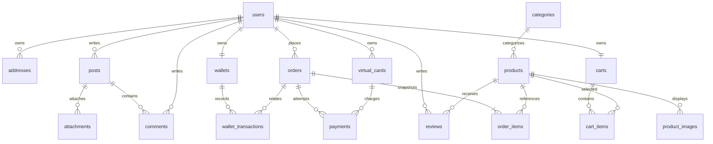
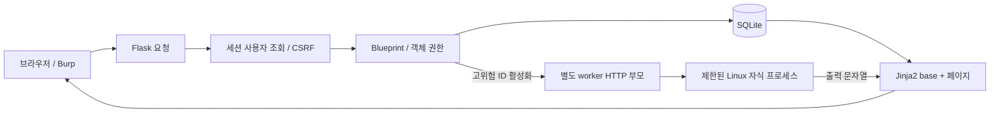
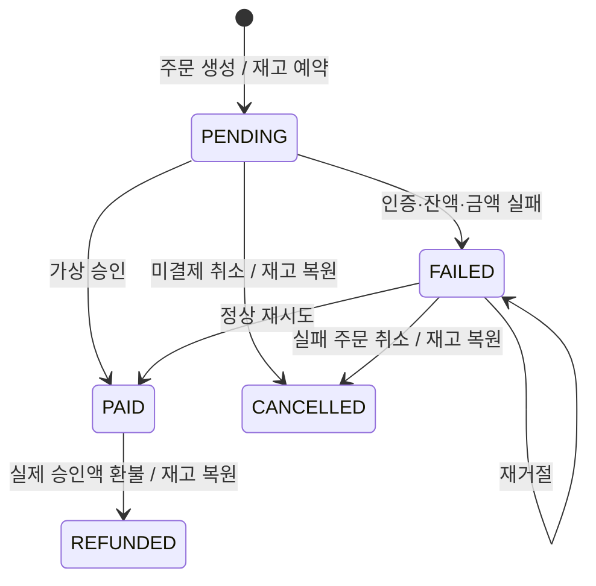

# VOLTIX 아키텍처

## 애플리케이션

`app.create_app()`은 환경설정 → instance 준비 → 스키마/seed → Blueprint 등록 → 세션/CSRF/템플릿 컨텍스트를 구성한다. python app.py는 Flask 개발 서버, Gunicorn은 같은 팩토리를 호출한다. 요청별 sqlite3 connection은 Flask g에 저장하고 teardown에서 닫는다. 외래키와 가격/재고/잔액 제약을 적용한다.

`routes`는 웹 입력/권한/응답을 담당하고 `services/payment_service.py`는 가상 결제 공급자와 트랜잭션을 담당한다. `vulnerabilities.enabled(ID)`가 개별 교육 모드를 결정한다. SQLi·escape 누락·권한 생략 등의 코드는 ID 주석과 문서 경로로 추적한다. 코드를 별도 데모 페이지에만 모으지 않고 정상 서비스 경로에서 비교한다.

## 데이터 관계



지갑 거래의 실제 외래키는 wallets.user_id와 users.id를 공유한다. 상품은 soft delete(active=0)하여 과거 주문 참조/환불을 보존한다. 주문은 이름·가격·수량과 배송지를 서버에서 스냅샷으로 저장한다. 쿠폰 테이블은 확장용이며 현재 결제 금액에 적용하지 않는다. payments는 주문별 여러 시도와 승인/거절 사유를 저장하고 환불 시 승인 기록을 REFUNDED로 전환한다. 초기 가상 주문 2개는 PENDING이며 재고를 예약한 상태다.

## 요청 흐름



일반 모드 Jinja2 자동 escape, SQL parameter binding, 소유자 및 role 검증, 모든 POST의 CSRF 검증을 사용한다. 취약 모드는 특정 경로에서만 검증을 생략한다. 업로드는 실행되지 않는 instance 디렉터리에 저장한다. 파일 실행/SSTI/shell은 메인 서버에서 절대 평가하지 않고 worker가 없으면 503이다.

## 주문·결제 상태



1. 장바구니는 회원별 서버 저장, 수량은 양수·재고 이하.
2. 주문 생성의 `BEGIN IMMEDIATE`에서 DB 상품 가격을 읽어 total 및 order_items 저장, 재고를 조건부 감소하고 장바구니 비움. 실패 시 전부 rollback.
3. 결제는 주문 소유자만 가능. 주문 상태/서버 주문 항목 합계를 읽고 요청 금액을 비교한다. VULN-11만 이 비교를 생략한다.
4. 공급자 registry(`wallet`, `card`)는 잔액 조건부 차감. 카드 식별자·유효기간·PIN 해시·한도를 검증한다. 신규 공급자는 registry 함수와 대응 환불 정책을 함께 확장한다.
5. 동일 transaction에서 payments에 요청/승인 결과와 주문 상태, 지갑 원장을 저장한다. PENDING/FAILED 이외의 상태는 승인하지 않는다. SQLite 쓰기 직렬화로 동시 중복 승인을 막는다.
6. 취소도 `BEGIN IMMEDIATE`. APPROVED가 있으면 실제 approved_amount만 환불하고 REFUNDED, 없으면 CANCELLED. 재고는 한 번만 복원한다.

PENDING/FAILED 주문의 자동 만료 작업은 없으며 사용자가 취소하거나 실습 DB를 초기화할 때 예약 재고가 복원된다. 결제 실패는 기록을 남기고 재시도할 수 있다. malformed/음수 금액은 요청 검증 단계에서 400이므로 결제 시도 레코드가 생성되지 않는다.

## 격리 실행 구조

Compose shop만 loopback 포트를 공개한다. worker는 내부 네트워크의 HTTP 서비스이며 Bearer token을 검사하고 사용자 소스를 HTTP 부모 프로세스에서 평가하지 않는다. 요청별 별도 자식에서 resource limits와 libseccomp를 적용한 후 Jinja2/Python/shell을 실행한다. 새 socket/connect와 namespace/ptrace/mount 등을 커널에서 거부하며 종료/timeout 후 프로세스 그룹을 정리한다. 출력 파일은 RLIMIT_FSIZE 32KB로 제한한다. worker root는 read-only이고 scratch는 tmpfs, host bind mount와 Docker socket은 없다. worker 환경에는 실제 개인정보/금융/서비스 비밀을 두지 않는다.

이 구조는 악성 코드에 대한 완전한 보안 경계 보장이 아니다. 컨테이너는 커널을 공유하므로 실제 실행은 학생별 일회용 VM 내부에서만 수행한다. 동일 worker의 scratch/process는 신뢰할 수 없으며 다른 학생의 세션과 공유하지 않는다. 직접 호스트에서 lab/child.py를 실행하지 않는다.

## Apache Reverse Proxy + Gunicorn

Apache는 추후 통합 배포용이며 로컬 실행 필수 조건이 아니다. Apache가 경로를 보존하여 Gunicorn loopback으로 전달한다.

```text
실습 브라우저 → Apache(교실 전용 접근 제한) → 127.0.0.1:5000 Gunicorn
                                                ↳ SQLite instance/
                                                ↳ 내부 worker (VM/Compose)
```

```bash
# 일반 비교 모드, worker 없음. .venv 활성화 후 실행
export VOLTIX_SECRET='인스턴스별-긴-무작위-키'
gunicorn --bind 127.0.0.1:5000 --workers 1 --threads 4 --access-logfile - 'app:create_app()'
```

샘플 Apache 설정은 `docs/apache-voltix.conf`. proxy/proxy_http 모듈과 VirtualHost/DNS는 배포 환경에서 설정한다. 인증 쿠키를 사용하는 서비스이므로 공개 도메인에서 사용하는 서비스로 전환하려면 TLS와 Secure cookie 등의 별도 운영 검토가 필요하다. 본 앱의 취약 모드는 교육 전용이다. Apache 하위 경로 prefix 배포는 현재 검증하지 않았으며 전용 VirtualHost 루트 경로 구성을 기본으로 한다.

## 로그 및 운영 범위

Flask/Gunicorn HTTP access/error 로그와 결제 order ID·method·결과 이벤트를 출력한다. POST body·비밀번호·PIN·카드 필드를 로깅하지 않는다. 업로드/DB는 instance에 저장하고 Git/이미지 빌드에서 제외한다. worker는 유실 가능한 임시 환경이다. DB 초기화는 명시 CLI로만 제공하고 웹 관리 메뉴에는 노출하지 않는다.
